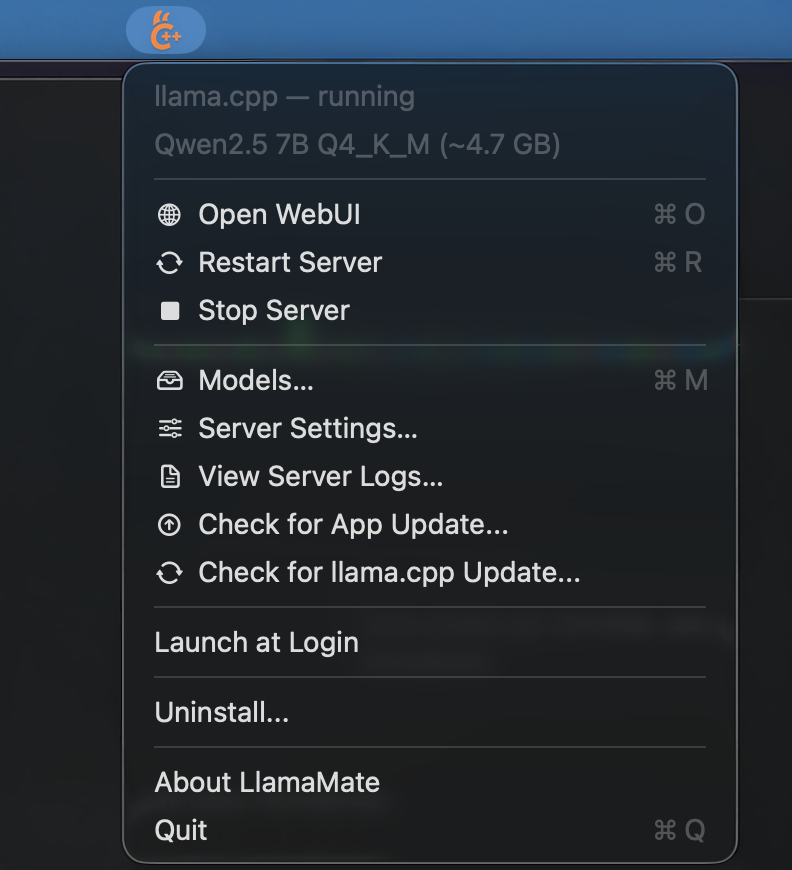
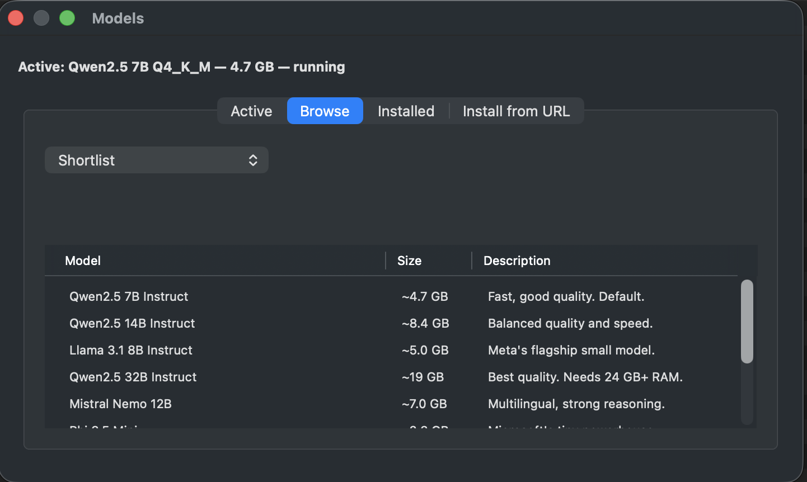
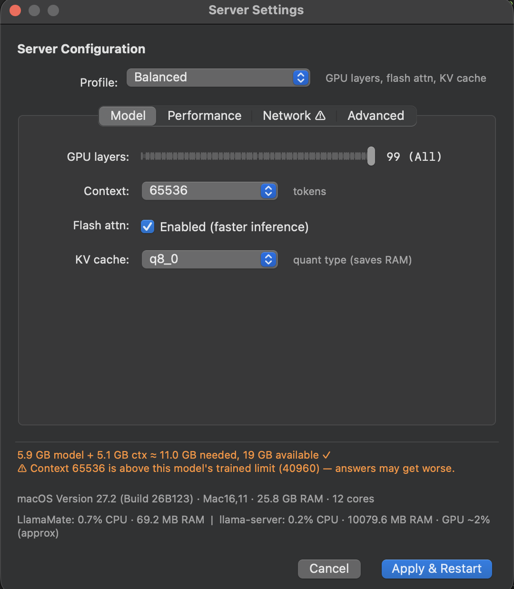

# Homebrew Tap for LlamaMate

Install [LlamaMate](https://github.com/Ito-69/llama.cpp_install_on_macos) via Homebrew Cask.

## Screenshots

| Menu bar | Models window |
|----------|---------------|
|  |  |

| Server Settings |
|-----------------|
|  |

## Install

```bash
brew tap Ito-69/llamamate
brew install --cask llamamate
```

Then open `LlamaMate` from `/Applications` (right-click → Open the first time, because the app is ad-hoc signed without an Apple Developer account).

## Update

```bash
brew upgrade --cask llamamate
```

## Uninstall

```bash
brew uninstall --cask llamamate
```

This quits the app, unloads the `com.llama.cpp.server` LaunchAgent, and removes
`LlamaMate.app`.

To also remove configuration, logs, and preferences, use `--zap`:

```bash
brew uninstall --zap --cask llamamate
```

`--zap` additionally deletes `~/Library/Application Support/LlamaMate`, the
LaunchAgent plist, the server logs, `~/Library/Preferences/com.llamamate.app.plist`,
`~/.config/llama`, and `~/.local/bin/llama-server-start.sh`.

Downloaded models in `~/models` and the llama.cpp binaries/libraries in
`~/.local/bin` and `~/.local/lib` are **never** removed by Homebrew. To delete
those too, use the in-app `Uninstall…` menu item before uninstalling the cask.
